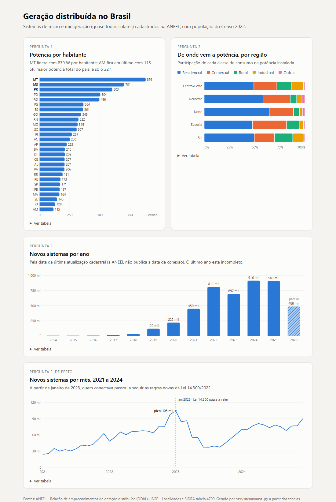

# Pipeline de geração distribuída no Brasil

Projeto final da pós (Eng. de Dados Jr.). Pipeline montado do zero com dados
públicos da ANEEL e do IBGE sobre **geração distribuída (GD)**: os sistemas
pequenos, quase todos painéis solares em telhado, que geram energia perto de
onde ela é consumida e ficam ligados na rede da distribuidora.

## Perguntas

1. Quais estados têm mais potência de GD **por habitante**? O total absoluto
   favorece estados grandes, então divido pela população.
2. Como as conexões cresceram ano a ano? E o que aconteceu perto da Lei
   14.300/2022, que mudou as regras de compensação para quem conectasse
   depois de janeiro de 2023?
3. Quanto da potência instalada vem de cada classe de consumo (residencial,
   comercial, rural, industrial...) em cada região do país?

## Fontes e licenças

| Arquivo em `data/raw/` | Origem | Licença |
|---|---|---|
| `aneel_gd.parquet` | [ANEEL – Relação de empreendimentos de geração distribuída](https://dadosabertos.aneel.gov.br/dataset/relacao-de-empreendimentos-de-geracao-distribuida) (versão de 10/10/2026) | [ODbL](https://opendatacommons.org/licenses/odbl/) |
| `ibge_municipios.json` | [IBGE – API de localidades](https://servicodados.ibge.gov.br/api/docs/localidades) | dado público do IBGE, uso livre citando a fonte |
| `ibge_populacao_2022.json` | [IBGE – SIDRA, tabela 4709](https://apisidra.ibge.gov.br/values/t/4709/n6/all/v/93/p/2022) (população residente, Censo 2022) | dado público do IBGE, uso livre citando a fonte |

Os arquivos não vão para o repositório (estão no `.gitignore`); o script de
ingestão baixa tudo de novo.

## Camadas

```
data/raw/*            arquivos como vieram da fonte (nada é alterado)
   │                  no DuckDB viram views em raw.*
   ▼
refined.*             limpeza e só as colunas que as perguntas usam
   │
   ▼
marts.*               um indicador por pergunta, pronto para ler
```

Tudo fica em `data/pipeline.duckdb`. O SQL de cada camada está em
`sql/refined/` e `sql/marts/`.

### O que é uma linha de cada tabela

| Tabela | Uma linha é... | Linhas (10/2026) |
|---|---|---|
| `raw.aneel_gd` | um sistema de GD cadastrado na ANEEL | 4.666.785 |
| `raw.ibge_municipios` | um município | 5.571 |
| `raw.ibge_populacao` | um município com a população de 2022 (+ 1 linha de cabeçalho) | 5.571 |
| `refined.municipios` | um município, com UF, região e população | 5.571 |
| `refined.gd_empreendimentos` | um sistema de GD, já limpo | 4.666.779 |
| `marts.potencia_por_uf` | uma UF | 27 |
| `marts.conexoes_por_ano` | um ano | 20 |
| `marts.conexoes_por_mes` | um mês entre 2021 e 2024 | 48 |
| `marts.classe_por_regiao` | uma classe de consumo dentro de uma região | 42 |
| `marts.classe_por_regiao_resumo` | o mesmo, com as classes pequenas juntas em "Outras" (para o painel) | 25 |

O JOIN entre as fontes é pelo código IBGE do município
(`CodMunicipioIbge` na ANEEL, `id` no IBGE). Todos os sistemas acharam o
seu município.

### O que a refined muda

- tira CPF/CNPJ, nome do titular e CEP (a ANEEL já publica mascarado, mas
  nenhuma pergunta usa);
- tira espaço sobrando da classe de consumo (`"REBR "` virava uma classe a mais);
- datas com ano 1900 (56 sistemas) viram nulas;
- tira 6 sistemas com potência 0;
- pega UF e região do IBGE pelo campo `regiao-imediata`, porque `microrregiao`
  vem nulo para municípios novos.

## Como rodar do zero

Testado no Windows com Python 3.12.

```bash
git clone https://github.com/regis-eduarda/pipeline-energia-solar.git
cd pipeline-energia-solar
python -m venv .venv
.venv\Scripts\activate
pip install -r requirements.txt
python src/pipeline.py
pytest
```

`pipeline.py` baixa os arquivos (~110 MB), monta a refined e os marts, gera
o painel e mostra as contagens de cada etapa. Se os arquivos já existirem em
`data/raw/`, o download é pulado. Também dá para rodar cada etapa sozinha:
`python src/ingestao.py`, `python src/refined.py`, `python src/marts.py`,
`python src/dashboard.py`.

Os testes (`tests/`) usam dado inventado num DuckDB em memória e não abrem o
banco do projeto.

## Painel

[`dashboard/painel.html`](dashboard/painel.html) é um arquivo HTML único
que abre direto no navegador (baixe e dê dois cliques). Ele tem um gráfico por
pergunta, mostra os valores ao passar o mouse e tem uma tabela embaixo de
cada gráfico. Quem gera o painel é `src/dashboard.py`, que lê **só as
tabelas `marts.*`** e só faz `select` e `order by`: nenhuma conta acontece no
painel.



## Resultados

**1. Potência por habitante.** O Centro-Oeste lidera: Mato Grosso tem
879 W por habitante, Mato Grosso do Sul 701 e Paraná 603. São Paulo tem a maior
potência total do país (7,6 GW), mas fica em 22º por habitante (171 W). Os
últimos são Rio de Janeiro (129 W) e Amazonas (115 W).

**2. Crescimento.** Os sistemas cadastrados por ano passaram de 270 em 2014
para 916 mil em 2024. O pico mensal foi em dezembro de 2022 (98 mil) e janeiro
de 2023 (105 mil), e depois o número cai até 37 mil em junho de 2023, o que
bate com a corrida para entrar antes das regras novas da Lei 14.300. 2023 foi
o único ano com queda (−14%). 2026 está incompleto (até outubro).

**3. Classes por região.** Residencial é cerca de metade da potência em todas
as regiões (58% no Nordeste). A classe rural pesa bem mais no Sul (18%) e no
Centro-Oeste (14%) do que no Nordeste (6,5%).

## Limitações

- **A data não é a de conexão.** O arquivo só tem `DthAtualizaCadastralEmpreend`,
  que o dicionário da ANEEL define como a data da *última* atualização cadastral.
  Um sistema ligado em 2019 e atualizado em 2024 aparece em 2024. A pergunta 2
  é uma aproximação, e a queda de 2023 pode estar mais suave ou mais forte do
  que foi de verdade.
- **REBR não está no dicionário.** São 47.844 sistemas. Pelo código (começa
  com RE), pelo subgrupo tarifário B1 (o mesmo do residencial) e por estarem
  concentrados no Maranhão e na Bahia, parece ser residencial baixa renda, mas
  não achei confirmação, então ficou como classe separada.
- **Boa Esperança do Norte (MT)** foi criado depois do Censo e não tem
  população. Os 34 sistemas dele entram na conta de MT, e isso está certo,
  porque os moradores foram contados no Censo dentro dos municípios de onde ele
  saiu.
- 988 sistemas residenciais passam de 75 kW (somam 0,73 GW), o que é grande
  para uma casa. Pode ser autoconsumo remoto cadastrado na classe do titular.
  Não mexi, mas é algo a investigar.

## Onde a IA errou

Usei IA (Claude) em todas as etapas, para escrever o código e o SQL e para
investigar o dado. Conferi cada etapa contando linhas antes e depois e olhando
o resultado. Onde ela errou ou assumiu algo que eu não pedi:

1. **Data de conexão que não existe.** A IA partiu do princípio de que a ANEEL
   publicava a data de conexão e sugeriu a pergunta 2 assim. Ao listar as
   colunas do arquivo, não tinha essa coluna. No dicionário de dados, a única
   data é a da última atualização cadastral. A pergunta ficou, mas virou
   aproximação (ver Limitações).
2. **Dado pessoal "aberto".** A IA disse que o arquivo trazia CPF/CNPJ e nome
   do titular. Olhando uma amostra, vi que a ANEEL já publica tudo mascarado
   (`***.477.072-**`, `***`). As colunas continuam fora da refined, mas o motivo
   não era o que ela falou.
3. **UF pelo campo errado.** Na primeira versão da refined, a UF vinha de
   `microrregiao`. Contando nulos, apareceu 1 município com `microrregiao`
   vazia (Boa Esperança do Norte, criado em 2023). Troquei para
   `regiao-imediata`, que vem preenchido para os 5.571.
4. **Mês com hora.** A coluna `mes` de `marts.conexoes_por_mes` saía como
   `2022-06-01 00:00:00`. Vi olhando o resultado e mudei para data.
5. **Função que não existe mais.** Um comando de conferência usou `fetchone()`,
   que saiu na versão 2.0 do DuckDB. Quebrou na hora; troquei por `fetchall()`.
6. **Soma de valores arredondados.** A primeira versão de
   `marts.classe_por_regiao_resumo` somava a potência de
   `marts.classe_por_regiao`, que já vem arredondada em MW. No dado real a
   diferença era pequena, mas o teste com dado inventado (sistemas de poucos kW)
   pegou: tudo virou 0,0 MW e a participação deu `NaN`. Passei a calcular
   direto da refined, em kW.

Conferências que passaram:
- a soma da população dá 203.080.756, o número oficial do Censo 2022;
- a soma dos marts por UF e por região fecha com os 4.666.779 sistemas da
  refined;
- a potência total é a mesma no raw e na refined (54,097 GW);
- quebrando o SQL de propósito (tirando o `trim` e o filtro de potência 0),
  6 dos 14 testes da época falharam;
- o resumo por região do painel fecha com `marts.classe_por_regiao` em todas
  as regiões (diferença máxima de 0,1 MW, de arredondamento).
